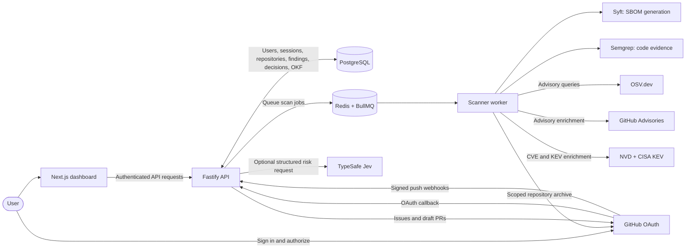

# DependencyShield — Software Supply Chain Security

DependencyShield helps teams find vulnerable open-source dependencies in GitHub repositories, understand which applications may be affected, and organize a human-reviewed response. It combines software inventory, vulnerability intelligence, dependency impact, code-analysis evidence, organizational context, and GitHub remediation workflows in one dashboard.

## What it does

- Connects GitHub repositories through a GitHub App with scoped installation access.
- Generates CycloneDX software bills of materials (SBOMs) with Syft.
- Checks installed package versions against OSV and enriches advisories with GitHub Security Advisories, NVD, and CISA Known Exploited Vulnerabilities data where available.
- Builds dependency graphs to show direct and transitive package relationships and affected paths.
- Runs Semgrep on repository archives and records possible package-usage evidence separately from confirmed vulnerability findings.
- Stores application and organizational context in versioned Google Open Knowledge Format (OKF) bundles.
- Supports structured risk decisions through TypeSafe Jev when configured, with a clearly identified deterministic fallback when it is unavailable.
- Creates GitHub issues and, for supported npm upgrades, draft pull requests after explicit user confirmation.
- Monitors repositories with scheduled scans, GitHub push webhooks, in-app alerts, and optional HTTPS alert forwarding.

## Architecture



### Main components

| Component | Purpose |
| --- | --- |
| `apps/web` | Next.js dashboard for repositories, findings, dependency graphs, knowledge, decisions, and remediation actions. |
| `apps/api` | Fastify REST API for GitHub authentication, authorization, data, scan scheduling, risk decisions, and remediation. |
| `apps/api/src/worker.ts` | BullMQ worker that processes repository scans and scheduled monitoring jobs. |
| `packages/shared-types` | Shared TypeScript types for the web and API. |
| `database/migrations` | PostgreSQL schema and incremental database changes. |
| PostgreSQL | Persistent user, repository, scan, SBOM, finding, knowledge, decision, and action data. |
| Redis + BullMQ | Background scan queue and recurring monitoring jobs. |
| Docker Compose | Local and container deployment for the web app, API, scanner, PostgreSQL, and Redis. |

## How a scan works

1. A user signs in with GitHub and installs the GitHub App for an account and selected repositories.
2. The user connects a repository, chooses a branch, and starts a scan.
3. The API verifies repository access and queues a scan. The worker uses a short-lived, repository-scoped GitHub installation token to fetch the selected commit archive.
4. The worker safely extracts the archive and runs Syft to create a CycloneDX SBOM. It does not install repository dependencies or execute repository scripts.
5. Dependency components and graph edges are stored. The scanner queries OSV and enriches relevant advisories with other configured intelligence sources.
6. The dashboard displays inventory, vulnerabilities, evidence, graph paths, and any coverage gaps. Unsupported package identities or unavailable data are labeled unknown/incomplete rather than assumed safe.

Scheduled scans run daily by default. GitHub push webhooks queue scans for the configured branch, pinned to the pushed commit. New vulnerable package versions can generate in-app alerts and optional HTTPS webhook notifications.

## Requirements

- Node.js 20 or newer
- pnpm 11
- Docker Desktop with Docker Compose
- A configured GitHub App for sign-in and repository access

## Quick start with Docker Compose

1. Copy `.env.example` to `.env` and fill in strong random values for `SESSION_SECRET`, `ENCRYPTION_KEY`, and `POSTGRES_PASSWORD`. Set the password in `DATABASE_URL` to the same value. Keep `.env` private; it is ignored by Git.
2. Configure the GitHub App values described below. Optional features such as live Jev decisions and alert forwarding need their respective credentials.
3. Install workspace dependencies and start the local database and queue:

   ```bash
   pnpm install
   docker compose up -d postgres redis
   ```

4. Apply the database schema and launch the application:

   ```bash
   pnpm db:migrate
   docker compose up -d --build
   ```

5. Open [http://localhost:3000](http://localhost:3000). API health is available at [http://localhost:4000/health](http://localhost:4000/health).

The Compose stack publishes service ports on `127.0.0.1` by default. For public use, place a TLS reverse proxy in front of the web/API services and keep PostgreSQL and Redis private. Set `TRUST_PROXY` only to the address of a trusted proxy.

### Development mode

After installing dependencies, start PostgreSQL and Redis and apply migrations as shown above. Run the web app and API with:

```bash
pnpm dev
```

Run the scanner worker in another terminal:

```bash
docker compose up -d --build scanner
```

## Configure the GitHub App

Create a GitHub App and set its local development URLs to:

- **Homepage:** `http://localhost:3000`
- **User authorization callback:** `http://localhost:4000/api/auth/github/callback`
- **Setup URL:** `http://localhost:4000/api/github/app-install/callback`
- **Webhook URL:** `https://<public-api-host>/api/github/webhook` (required for push-triggered scans)

For read-only inventory and scanning, grant **Contents: Read-only** and **Metadata: Read-only**. Subscribe to **Push**, **Repository**, **Installation**, and **Installation repositories** events. Set the webhook secret in `GITHUB_WEBHOOK_SECRET`.

To enable issue and draft pull request remediation, also grant **Issues: Read and write**, **Contents: Read and write**, **Pull requests: Read and write**, and **Checks: Read-only**. Approve the updated permissions for each installation. Configure `GITHUB_CLIENT_ID`, `GITHUB_CLIENT_SECRET`, `GITHUB_APP_ID`, `GITHUB_APP_SLUG`, and `GITHUB_APP_PRIVATE_KEY_B64` in `.env`. The private key should be base64 encoded; never commit the original key or its encoded value.

The sign-in flow uses OAuth state and PKCE. GitHub repository operations use short-lived installation tokens with repository-scoped permissions.

## Risk decisions and remediation

Set `TYPESAFE_API_KEY` and a pinned `JEV_MODEL_VERSION` to enable live TypeSafe Jev risk decisions. Requests contain minimized structured evidence and organizational context; repository source and file paths are not sent. Without a key, decisions use an explicitly labeled deterministic policy fallback.

Users can create GitHub issues or request a draft pull request after explicit confirmation. Draft upgrades currently support direct npm dependencies when OSV supplies an unambiguous fixed version. A root npm `package-lock.json` can be updated with lifecycle scripts disabled. Unsupported lockfile formats and workspace/private-registry cases are refused. DependencyShield does not merge PRs or mark them ready; maintainers should review the diff, run tests, and approve changes in GitHub.

## Security and data handling

- Repository access is checked against the user's GitHub App installation; session cookies are HttpOnly and use Secure in production.
- The scanner runs in a constrained container with a read-only root filesystem, dropped Linux capabilities, resource limits, and a bounded temporary filesystem.
- Repository archives are size limited and extracted with path/link safety checks. Project scripts are not executed.
- GitHub webhooks are verified using HMAC signatures over the raw request body and deduplicated by delivery ID.
- Local `.env` files, private keys, certificates, database files, logs, and generated build output are excluded by `.gitignore`.

## Current boundaries

- Each connected repository currently maps to one application; independently deployable apps inside monorepositories are not auto-discovered.
- Initial vulnerability matching supports npm, PyPI, Maven, Go, and Cargo package identities. Local range evaluation covers npm, Go, Cargo, and PyPI formats; unsupported or conflicting formats remain unknown.
- Semgrep findings and package import matches are evidence for review, not proof that vulnerable code is reachable or exploitable.
- Maven local range evaluation and remediation for pnpm, Yarn, npm shrinkwrap, workspaces, and private registries remain future work.
- Real GitHub, TypeSafe, advisory-enrichment, webhook, and public HTTPS behavior still depends on configuring external credentials and exercising the integration in the target environment.

## Project documentation

- [Architecture notes](docs/architecture.md)
- [Implementation status and integration checklist](docs/implementation-status.md)
- [OKF knowledge design](docs/okf-knowledge.md)
- [Jev risk decision design](docs/jev-risk-decisions.md)
